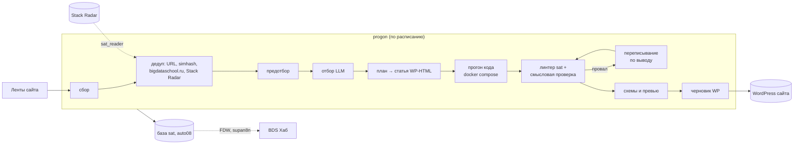

# RUNBOOK — bds-satellites

handbook: v0.1. Общая часть конвейера сайтов-спутников. То, что относится к конкретному сайту (день,
секреты, WP), — RUNBOOK репо `bds-sat-<site>`.

## 1. Назначение

Раз в неделю на сайт 1–2 статьи из второстепенных источников: разбор, свой материал с таблицей и схемой,
практика с кодом, прогнанным на стенде, 2–3 задания с решениями. Участие автора — оценка черновиков в WP.
Telegram не используется.

Работа идёт тактами (ADR 0002 §3): таймер сайта три раза в сутки запускает `sat tick`. За такт у темы не больше
одного шага (статья, стенд, проверки, правка); превью, схемы и публикация готового — в том же такте. Новые темы
выбираются первым тактом недели сайта (с 00:00 МСК `schedule.day`). Расход за неделю — не больше
`llm.maxCostPerWeekUsd`, за запуск — не больше `maxCostPerRunUsd`. Полный прогон всех шагов — `sat run`
(`SAT_FORCE=1` в юните, RUNBOOK сайта §9).

## 2. Архитектура



Статусы кандидата: `new → (dup|bds|radar|skip) → picked → drafted → ran|run_failed → ready|gate_failed → published`
(`published` — пост вышел на сайте, статья принята автором: конвейер её больше не проверяет, не правит,
не обновляет в WP и не шлёт о ней ошибок, переделка только `sat adopt`; `rejected` — план сказал «не брать», пост удалён в WP вручную или проверки не пройдены за
`gates.maxRevisionsTotal` правок, ADR 0004; `unreadable` — текст исходника не получен, см. §5).

**Где стоит WordPress (ToDo 18, со слов автора 17.11).** bigdataschool.ru — Timeweb Cloud (5.42.103.133);
kafka-school.ru, spark-school.ru, python-school.ru — один VDS Timeweb (213.171.3.125, там же babok-school.ru).
Доступ к файлам — файловый менеджер панели Timeweb и ssh, у нас доступа нет. Плагины и mu-плагины выкладывает
и правит webmaster: передать ему файл из репо и путь назначения `wp-content/mu-plugins/`. Проверка после
выкладки — запрос `OPTIONS` к REST (`curl -s -X OPTIONS https://<домен>/wp-json/wp/v2/posts`, в `schema.properties.meta` есть `_yoast_wpseo_title`). На 17.11 mu-плагины SEO стоят на всех четырёх сайтах.

## 3. Карта файлов на хосте

На progon у каждого сайта своё (RUNBOOK сайта §3): `/opt/bds-sat-<site>` (пакет — `node_modules/bds-satellites`),
`/etc/bds-sat-<site>.env`, `/var/lib/bds-sat-<site>/{state.db,drafts,runs}`. Общий для сайтов на progon —
только образ `bds-sat-visuals:<версия>`. Каталог черновика: `<slug>.html`, `<slug>_meta.md`, картинки
`<slug>_schemeN.jpg`, `<slug>_preview.jpg`, служебное в `.work/` (`research.json`, `run.json`, `gates.json`,
`media.json`).

## 4. Секреты

Список — `templates/site/deploy/bds-sat-__SITE__.env.example`: ключ OpenRouter сайта, WP-логин и
Application Password, `SAT_DB_URL` (sat_writer), `STACKRADAR_RO_URL` (sat_reader). Роли и сеть на auto08 —
RUNBOOK stack-radar §5. `DOCS_DB_URL` (docs_reader через пулер supan8n) и `DOCS_OLLAMA_URL` — индекс документации
bds-docs-index по Tailscale; секция `docs_index` в `site.yaml` перечисляет продукты и версии стенда. Нет переменных или
supan8n недоступен — план и статья идут без фрагментов индекса, в `fetchLog` строка `docs-index`.

Подписка Claude для моделей `claude-cli:<alias>` (с v0.1.35): `CLAUDE_CODE_OAUTH_TOKEN` — токен из
`claude setup-token` (год, вход автора), бинарь `claude` в PATH пользователя сайта или `SAT_CLAUDE_BIN`. Пороги —
`llm.claudeCli` в `site.yaml`: `fiveHourMax` 0.3, `lastDayFiveHourMax` 0.6, `maxAgeMin` 15, `probeModel` haiku.
Нет токена, бинаря или порог занят — этап уходит на следующую модель списка; последние сведения о лимитах —
`$SAT_STATE_DIR/claude-limits.json`.

## 5. Данные и БД

Текст от автора: кандидат в статусе `unreadable` (хаб, `sat.runs.stats.need_author_text`, причина в
`candidates.skip_reason`) ждёт файл `/var/lib/bds-sat-<site>/source-text/<id кандидата>.md`, от 300 слов,
владелец — пользователь сайта. Следующий шаг `draft` вернёт кандидата в работу.

- `state.db` сайта (SQLite, `node:sqlite`): миграции в `src/lib/state/db.ts`, только добавление.
- База `sat` на auto08: `sat.articles`, `sat.runs`. Хаб читает через FDW на supan8n.

## 6. Деплой

Пакет: ветка → гейт → merge в `main` → тег `vX.Y.Z`. Сайт поднимает тег в своём `package.json` и
деплоится по RUNBOOK сайта §6 (`ops/deploy-site.sh`: ff-only, npm install со сборкой, образ визуализации,
selfcheck, smoke). Откат — прежний тег в `package.json` сайта.

## 7. Мониторинг и алерты

- Юнит сайта с `OnFailure=alert@%n.service` — упал сам прогон.
- `ops/checks.d/bds-satellites.sh` на auto08: `sat_run:<site>` (нет прогона без ошибки 8/14 суток),
  `sat_stuck` (черновики без прохода проверок > 14 суток), `sat_db`.
- Хаб: «Спутники» — статьи и прогоны, расход, ошибки.
- Общий журнал расхода LLM: каждый вызов модели и картинка — строка в `llm.calls` на supan8n (project
  `bds-satellites`, site, этап, модель ответа, токены, $, ref = id кандидата). DSN `LLM_LEDGER_DB_URL` в env
  сайта (пишет bds-content `ops/llm_ledger_setup.sh`). Сбой журнала — строка `[llm-ledger]` в логе, прогон идёт.
  Расход за неделю: `select * from llm.weekly where project = 'bds-satellites' order by week desc;` (pg-mcp).

## 8. Ежедневное сопровождение

После прогонов сайтов: хаб → «Спутники»; расход OpenRouter против лимита ключа. В WP уходит только `ready`
(ADR 0004, v0.1.52): провал любых проверок пост не создаёт и не обновляет, в журнале `stats.gate_held`;
провал стиля дополнительно — `stats.style_blocked`. Тема, не прошедшая проверки за
`gates.maxRevisionsTotal` правок, снимается сама (`rejected`), вместо неё берётся тема из пула:
`stats.dropped` (id, причина, замена). Невышедший пост снятой темы уходит в корзину WP (`stats.wp_trashed`); если роль WP не даёт удалить (author и расписание, 403), пост снимается в черновик (`stats.wp_trash_denied`). Вернуть снятую тему: `sat rework <id> --force` (без флага rework откажет теме с выбранным потолком). Раз в неделю отчёт stack-radar шлёт отдельным
сообщением «Спутники: брак и круги»: сколько денег ушло на снятые темы и почему, с какого круга правок
статьи проходят проверки. Данные — `sat.articles` и `sat.runs.stats.ledger` (правки и причина по теме).
Вышедший пост
(статус берётся с сайта в начале прогона: по расписанию, руками автора, из `sat adopt`) — тема `published`, в журнале `stats.accepted`. Жирный в лиде ставит код
по строке meta «Главные термины» (`article/html.ts` `leadTerms`), модель его не трогает.

Переделка старого поста (`sat adopt`, с v0.1.41): кандидат идёт обычными тактами, публикация обновляет
этот пост. Опубликованный пост меняет только версия без провала проверок; пока провал — `stats.gate_held`.

A/B моделей черновика (секция `llm.ab` в `site.yaml`, ADR 0002 §2): раз в неделю `sat ab-report` на каждом
сайте. Темы делятся поровну, вариант темы не меняется. Откат на запасную модель виден в `llm_calls.model`.

## 9. Ручная проверка step-by-step

На wsa100, без сети к сервисам сайта:

```bash
npm run gate                                                   # всё зелёное
SAT_SITE_DIR=../bds-sat-kafka SAT_STATE_DIR=/tmp/sat scripts/sat.mjs collect   # JSON: feeds, added, prefilter
```

Полный прогон сайта — RUNBOOK сайта §9.

## 10. Новый хост

Пакет на хост не ставится отдельно: его ставит `npm install` сайта. Нужны Node 22, python3, Docker, git;
образ визуализации собирает `deploy-site.sh`. Первая установка сайта — одной командой автора на wsa100:
`ops/bootstrap-site.sh <site>` (progon, установщик сайта, deploy key, секреты из `~/.config/sat/` через stdin,
деплой). Мне эти шаги классификатор не даёт: создание пользователей, `sudo` и секреты на хосте.

Модели `claude-cli:` (с v0.1.35) — ещё Claude Code на хосте, общий для сайтов, версия как на wsa100:
`sudo npm install -g --no-audit --no-fund @anthropic-ai/claude-code@2.1.326` (на progon стоит с 17.11).
Токен и `DISABLE_AUTOUPDATER=1` — в env каждого сайта (§4): обновляется CLI только этой командой, с новой версией.
`~/.claude` пишется в дом пользователя сайта, это его каталог состояния.

## 11. Аварии

| Симптом | Причина | Действие |
|---|---|---|
| `write: ответ обрезан по maxTokens` | рассуждение Claude 5 съело ответ | с v0.1.14 потолок 64k; повторяется — `llm.reasoning` в конфиге сайта (effort ниже); handbook gotchas/llm.md#claude5-reasoning |
| `SyntaxError` разбора JSON | код с ``` внутри ответа | `parseJson` уже это учитывает; если всё равно падает — `.work/` и ответ модели |
| линтер: «Двоеточия в заголовках», «Тег code» | модель отошла от Style Guide | переписывание закрывает это само; повторяется — правка `prompts/write.md` |
| `правка не принята: … фрагмента нет в статье дословно` (или «встречается N раз», «нет пар») | правка шлёт пары «было → стало» (с v0.1.33), модель дважды процитировала фрагмент не дословно | статья не тронута, следующий прогон правит снова; ответ модели — `.work/revise.rejected.txt`; повторяется — `prompts/revise.md`, раздел «Правила пар» |
| превью: «в ответе нет картинки» | модель ответила текстом три раза подряд, причина в скобках | следующий прогон попробует снова; повторяется — `llm.models.image`; основная gemini-2.5-flash-image, откат — вторая модель пары (gemini-3-pro-image-preview), с v0.1.34 |
| превью: HTTP 402, «requires at least $1.00 in balance» | баланс OpenRouter меньше $1 (порог для картинок, текст ещё идёт) | пополнить баланс; превью догенерирует следующий прогон |
| превью: «потолок прогона» | расход дошёл до `llm.maxCostPerRunUsd` раньше конца прогона | ничего: следующий прогон начинает с `visuals`, обложка появится и у поста в WP |
| превью: `delegate failed 'ufraw-batch'` | сырой файл с расширением `.raw` (до v0.1.11) | пакет ≥ v0.1.11; превью догенерирует следующий прогон или `sat visuals <id>` |
| `run.json`: «нет run.sh или плохие имена: » (пустой список) | `run.sh` с shebang, имя во второй строке (до v0.1.13) | пакет ≥ v0.1.13 |
| задания `*.py` падают без JVM/рантайма на хосте | раннер зовёт `.venv/bin/python` | `stand.pyRun` в конфиге сайта (spark — `spark-submit` в контейнере) |
| схема не рендерится, Parse error | ошибка Mermaid в метаданных | черновик остаётся с `TODO_IMAGE`, правка в `_meta.md` и `sat visuals <id>` |
| progon выключился посреди ручного прогона | `run-site.sh` запущен из ssh, lock в `/tmp` | только через юнит, RUNBOOK сайта §9; с v0.1.9 скрипт вне юнита отказывается |
| прогон убит `status=15/TERM`, следом «пропуск» | unattended-upgrades + needrestart перезапустили юнит | `/etc/needrestart/conf.d/bds-sat.conf` ставит установщик сайта с v0.1.10; повторить §9 сайта |
| в `fetchLog` «адрес вне разделов документации», `docs` в промпте «(нет)» | модель назвала страницу вне `docs` в `site.yaml`, нужной страницы нет в списке | добавить страницу или раздел в `docs`, проверить чтением (её текст, а не оглавление) |
| кандидаты уходят в `unreadable` | сайт закрыт роботу, r.jina.ai ограничил анонимный доступ | §5, текст от автора; цепочка — `.work/research.json`, `fetchLog` |
| `brand обязателен`, `brand: … цвет палитры bigdataschool.ru` при запуске или в гейте сайта | блок `brand` не заполнен или в нём цвет BDS | `sat brand-suggest` печатает предложение, автор подтверждает, блок в `config/site.yaml` |
| selfcheck: FAIL `brand сходится с главной сайта` | сайт сменил стиль, палитра с другим оттенком или главная недоступна | `sat brand-check` печатает цвета главной и причину, поправить `brand`; уже готовые картинки сами не обновятся |
| `<этап>: claude-cli:… — окно 5 ч занято на N %, порог 30 %` (или «неделя … темп») | подписку тратит автор, конвейер уступает | ничего: этап сделала следующая модель списка; часто — `llm.claudeCli` в `site.yaml` |
| `<этап>: claude-cli:… — проба подписки не удалась: … stderr: …` | нет `claude`, токен просрочен или неверен | §4: `claude setup-token`, токен в env сайта; до тех пор работает откат |
| `<этап>: <модель> — модель не ответила после повторов, дальше …` | сбой провайдера на одной модели | ничего, если ответила следующая; все упали — ошибка этапа, следующий прогон повторит |
| `журнал: не записан` | sat на auto08 недоступна | статьи не теряются, `sat sync` после восстановления |

## 12. Шпаргалка

```bash
npm run gate                                  # гейт
ops/new-site.sh python python-school.ru fri ../bds-sat-python   # тонкий репо нового сайта
scripts/sat.mjs gates 13                      # шаг по одному кандидату (id из state.db)
scripts/sat.mjs sync                          # переписать журнал хаба по всем черновикам
scripts/sat.mjs adopt 9183 https://… Заголовок  # старый пост WP переделать по новым правилам (ToDo 97)
scripts/sat.mjs ab-report                     # итог A/B моделей черновика по вариантам
scripts/sat.mjs brand-check                   # brand против цветов главной сайта
scripts/sat.mjs brand-suggest --domain x.ru   # предложение палитры нового сайта
# brand: { primary: "#RRGGBB", accent: "#RRGGBB", background: "#RRGGBB", text: "#RRGGBB" }
```
