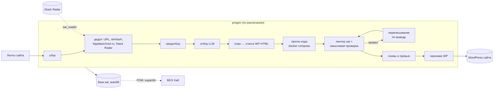

# RUNBOOK — bds-satellites

handbook: v0.1. Общая часть конвейера сайтов-спутников. То, что относится к конкретному сайту (день,
секреты, WP), — RUNBOOK репо `bds-sat-<site>`.

## 1. Назначение

Раз в неделю на сайт 1–2 статьи из второстепенных источников: разбор, свой материал с таблицей и схемой,
практика с кодом, прогнанным на стенде, 2–3 задания с решениями. Участие автора — оценка черновиков в WP.
Telegram не используется.

## 2. Архитектура



Статусы кандидата: `new → (dup|bds|radar|skip) → picked → drafted → ran|run_failed → ready|gate_failed`
(`rejected` — план сказал «не брать»).

## 3. Карта файлов на хосте

На progon у каждого сайта своё (RUNBOOK сайта §3): `/opt/bds-sat-<site>` (пакет — `node_modules/bds-satellites`),
`/etc/bds-sat-<site>.env`, `/var/lib/bds-sat-<site>/{state.db,drafts,runs}`. Общий для сайтов на progon —
только образ `bds-sat-visuals:<версия>`. Каталог черновика: `<slug>.html`, `<slug>_meta.md`, картинки
`<slug>_schemeN.jpg`, `<slug>_preview.jpg`, служебное в `.work/` (`research.json`, `run.json`, `gates.json`,
`media.json`).

## 4. Секреты

Список — `templates/site/deploy/bds-sat-__SITE__.env.example`: ключ OpenRouter сайта, WP-логин и
Application Password, `SAT_DB_URL` (sat_writer), `STACKRADAR_RO_URL` (sat_reader). Роли и сеть на auto08 —
RUNBOOK stack-radar §5.

## 5. Данные и БД

- `state.db` сайта (SQLite, `node:sqlite`): миграции в `src/lib/state/db.ts`, только добавление.
- База `sat` на auto08: `sat.articles`, `sat.runs`. Хаб читает через FDW на supan8n.

## 6. Деплой

Пакет: ветка → гейт → merge в `main` → тег `vX.Y.Z`. Сайт поднимает тег в своём `package.json` и
деплоится по RUNBOOK сайта §6 (`ops/deploy-site.sh`: ff-only, npm install со сборкой, образ визуализации,
selfcheck, smoke). Откат — прежний тег в `package.json` сайта.

## 7. Мониторинг и алерты

- Юнит сайта с `OnFailure=alert@%n.service` — упал сам прогон.
- `ops/checks.d/bds-satellites.sh` на auto08: `sat_run:<site>` (нет прогона без ошибки 8/14 суток),
  `sat_stuck` (черновики без прохода проверок > 14 суток), `sat_db`.
- Хаб: «Спутники» — статьи и прогоны, расход, ошибки.

## 8. Ежедневное сопровождение

После прогонов сайтов: хаб → «Спутники»; расход OpenRouter против лимита ключа; черновики `gate_failed` —
что не прошло (комментарий в начале поста в WP).

## 9. Ручная проверка step-by-step

На wsa100, без сети к сервисам сайта:

```bash
npm run gate                                                   # всё зелёное
SAT_SITE_DIR=../bds-sat-kafka SAT_STATE_DIR=/tmp/sat scripts/sat.mjs collect   # JSON: feeds, added, prefilter
```

Полный прогон сайта — RUNBOOK сайта §9.

## 10. Новый хост

Пакет на хост не ставится отдельно: его ставит `npm install` сайта. Нужны Node 22, python3, Docker, git;
образ визуализации собирает `deploy-site.sh`. Первая установка сайта — одной командой автора на wsa100:
`ops/bootstrap-site.sh <site>` (progon, установщик сайта, deploy key, секреты из `~/.config/sat/` через stdin,
деплой). Мне эти шаги классификатор не даёт: создание пользователей, `sudo` и секреты на хосте.

## 11. Аварии

| Симптом | Причина | Действие |
|---|---|---|
| `write: ответ обрезан по maxTokens` | рассуждение Claude 5 без effort | `llm.reasoning` в конфиге сайта; handbook gotchas/llm.md#claude5-reasoning |
| `SyntaxError` разбора JSON | код с ``` внутри ответа | `parseJson` уже это учитывает; если всё равно падает — `.work/` и ответ модели |
| линтер: «Двоеточия в заголовках», «Тег code» | модель отошла от Style Guide | переписывание закрывает это само; повторяется — правка `prompts/write.md` |
| превью: «в ответе нет картинки» | модель картинок недоступна | `llm.models.image`, запасная — gemini-2.5-flash-image |
| превью: `delegate failed 'ufraw-batch'` | сырой файл с расширением `.raw` (до v0.1.11) | пакет ≥ v0.1.11; превью догенерирует следующий прогон или `sat visuals <id>` |
| `run.json`: «нет run.sh или плохие имена: » (пустой список) | `run.sh` с shebang, имя во второй строке (до v0.1.13) | пакет ≥ v0.1.13 |
| задания `*.py` падают без JVM/рантайма на хосте | раннер зовёт `.venv/bin/python` | `stand.pyRun` в конфиге сайта (spark — `spark-submit` в контейнере) |
| схема не рендерится, Parse error | ошибка Mermaid в метаданных | черновик остаётся с `TODO_IMAGE`, правка в `_meta.md` и `sat visuals <id>` |
| progon выключился посреди ручного прогона | `run-site.sh` запущен из ssh, lock в `/tmp` | только через юнит, RUNBOOK сайта §9; с v0.1.9 скрипт вне юнита отказывается |
| прогон убит `status=15/TERM`, следом «пропуск» | unattended-upgrades + needrestart перезапустили юнит | `/etc/needrestart/conf.d/bds-sat.conf` ставит установщик сайта с v0.1.10; повторить §9 сайта |
| `журнал: не записан` | sat на auto08 недоступна | статьи не теряются, `sat sync` после восстановления |

## 12. Шпаргалка

```bash
npm run gate                                  # гейт
ops/new-site.sh python python-school.ru fri ../bds-sat-python   # тонкий репо нового сайта
scripts/sat.mjs gates 13                      # шаг по одному кандидату (id из state.db)
scripts/sat.mjs sync                          # переписать журнал хаба по всем черновикам
```
