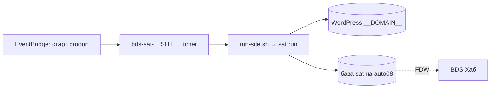

# RUNBOOK — bds-sat-__SITE__

handbook: v0.1. Общая часть конвейера (шаги, проверки, стенд, журнал) — RUNBOOK bds-satellites; здесь —
то, что относится к __DOMAIN__.

## 1. Назначение

Раз в неделю (__DAY__, 02:00 МСК) 1–2 статьи для __DOMAIN__ из лент сайта: разбор исходника, свой материал,
практика с кодом, прогнанным на стенде, задания. Черновики в WordPress сайта, итоги в BDS Хабе.

## 2. Архитектура



Схема шагов конвейера — RUNBOOK bds-satellites §2.

## 3. Карта файлов на хосте (progon)

| Путь | Что |
|---|---|
| `/opt/bds-sat-__SITE__` | клон репо, владелец `bds-sat-__SITE__`; пакет — `node_modules/bds-satellites` |
| `/etc/bds-sat-__SITE__.env` | секреты, `640 root:bds-sat-__SITE__` |
| `/var/lib/bds-sat-__SITE__/` | состояние: `state.db`, `drafts/<slug>/`, `runs/`, `PAUSE` |
| `/var/lib/bds-sat-__SITE__/.ssh/` | read-only deploy keys: репо сайта, bds-satellites |
| `/etc/systemd/system/bds-sat-__SITE__.{service,timer}` | из `deploy/` |

## 4. Секреты

`deploy/bds-sat-__SITE__.env.example` — список с комментариями. Ротация: новый ключ OpenRouter или
Application Password WP → правка `/etc/bds-sat-__SITE__.env` → `ops/selfcheck.sh` пакета (§9).

## 5. Данные и БД

Локально — `state.db` (SQLite, миграции в пакете). Журнал для хаба — база `sat` на auto08 (RUNBOOK
stack-radar §5). Бэкап: `state.db` восстановим заново (пул собирается из лент), черновики — в WP.

## 6. Деплой

```bash
stand_progon.sh up                                                   # на wsa100: включить progon
ssh progon 'sudo -u bds-sat-__SITE__ -H bash -lc "cd /opt/bds-sat-__SITE__ && node_modules/bds-satellites/ops/deploy-site.sh"'
```

Отказ при грязном дереве или без fast-forward. Откат: `git checkout <тег>` в `/opt/bds-sat-__SITE__`,
`npm install`. Подъём версии пакета — правка тега в `package.json` отдельным коммитом.

## 7. Мониторинг и алерты

- `OnFailure=alert@%n.service` — упал сам прогон, тревога в LOGS (toolkit monitoring на progon).
- Сторож на auto08 `checks.d/bds-satellites.sh`: `sat_run:__SITE__` — нет прогона без ошибки 8/14 суток;
  `sat_stuck` — черновики без прохода проверок дольше 14 суток.
- BDS Хаб, раздел «Спутники»: статьи, статусы, расход, ошибки за 7 дней.

## 8. Ежедневное сопровождение

Раз в неделю после прогона: хаб → «Спутники» → черновики в WP (ссылка из таблицы), решение по каждому.

## 9. Ручная проверка step-by-step

```bash
stand_progon.sh up
ssh progon 'sudo -u bds-sat-__SITE__ -H bash -lc "set -a; . /etc/bds-sat-__SITE__.env; set +a; /opt/bds-sat-__SITE__/node_modules/bds-satellites/ops/selfcheck.sh"'   # все OK
ssh progon 'sudo systemctl start bds-sat-__SITE__.service; journalctl -u bds-sat-__SITE__ -n 5 --no-pager'  # не в свой день — «пропуск»
ssh progon 'sudo systemctl set-environment SAT_FORCE=1 && sudo systemctl start --no-block bds-sat-__SITE__.service && sudo systemctl unset-environment SAT_FORCE'   # полный прогон вне дня
ssh progon 'systemctl is-active bds-sat-__SITE__; journalctl -u bds-sat-__SITE__ -n 30 --no-pager -o cat'   # inactive — готово, JSON итога в конце
```

Полный прогон — только через юнит: lock в `/run/bds-sat-__SITE__/` держит progon включённым. Из ssh напрямую
`run-site.sh` откажется, иначе сторож простоя выключил бы сервер через 30 минут.

Ожидаемо: в хабе новая строка «Прогоны», статьи в «Спутниках», черновики в WP.

## 10. Новый хост

`ops/install-site.sh` (пользователь, ключи, клон, env, юниты, сторож простоя) → заполнить env → §6 → §9.

## 11. Аварии

| Симптом | Причина | Действие |
|---|---|---|
| `sat_run` crit, progon выключен | EventBridge не стартовал инстанс | консоль AWS → расписание; разово `stand_progon.sh up` и §9 |
| прогон «пропуск: чужие контейнеры» | на стенде идёт статья блога | ничего: следующий прогон через неделю, или §9 с `SAT_FORCE=1` |
| WP 401 `rest_not_logged_in` | Wordfence или логин не тот | handbook gotchas/wordpress.md#app-password-401 |
| статья обрезана, `finishReason=length` | рассуждение модели съело ответ | handbook gotchas/llm.md#claude5-reasoning |

## 12. Шпаргалка

```bash
ssh progon 'sudo -u bds-sat-__SITE__ touch /var/lib/bds-sat-__SITE__/PAUSE'    # пауза прогонов
ssh progon 'systemctl list-timers bds-sat-__SITE__.timer --no-pager'           # следующий прогон
ssh progon 'journalctl -u bds-sat-__SITE__ -n 100 --no-pager'                  # лог последнего прогона
```
